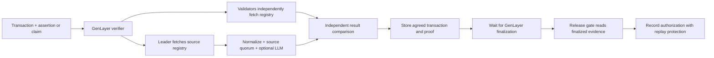

# Architecture and trust boundary

The verifier's authoritative output is an on-chain record produced by GenLayer consensus over independently fetched external evidence. A frontend supplies a chain ID, transaction identifier, and optionally a structured assertion or natural-language claim. It can preview and index results, but it cannot submit a precomputed verdict for the contract to approve.

## Evidence pipeline

`_build_plan` snapshots storage into plain Python before entering `gl.vm.run_nondet`. The leader and every validator run the same `run_pipeline`. Network requests and optional LLM calls remain inside that nondeterministic block. Storage updates and event emission occur after consensus.

EVM JSON-RPC sources use one batch for chain ID, transaction, receipt and head. Replies must include the requested IDs exactly once, including explicit `result: null` when an object is absent. A source returning a wrong or missing configured chain ID is rejected. Returned transaction and receipt identifiers must match the requested hash, and their inclusion fields must agree. Receipt-less/pruned sources can corroborate transaction identity but cannot corroborate event logs.

Blockscout v2 supplies indexed transaction details and paginated logs. The adapter follows bounded pagination, rejects repeated pages and log indices, and restores receipt log order by index. Etherscan v2 proxies EVM calls and requires an API key. Solana requests `getTransaction` with finalized commitment, binds the returned first signature to the request, and separately reads the slot head; program log messages become topic-less log entries.

The identity digest covers sender, recipient, native value, selector and nonce. The settlement digest covers execution status, block number, transaction index, created contract and all normalized logs in order. These are summary commitments, not recovered-signature checks or light-client inclusion proofs.

## Source quorum

Positive observations are grouped by identity. A tie produces a disputed, unconfirmed result. Identity quorum and receipt settlement quorum are enforced separately. Within the winning identity group, the largest settlement group wins; tied settlement groups cannot confirm. One source reporting only a transaction object does not reduce the configured receipt quorum.

Confirmation depth is selected from the quorum-th deepest observation in the winning settlement group. This prevents a single unusually high head from independently establishing confirmation. Collection stops after a matching identity-and-settlement quorum; later configured sources need not be queried. Thus the record proves corroboration by the reported sources, not unanimity across every registry source.

Absence needs at least the configured quorum of explicit absent replies, with no positive observations. Errors do not count as absence. With no usable evidence, the pipeline raises a transient error instead of caching a fabricated negative result.

Removing sources or lowering the query budget never silently lowers quorum. An impossible source budget rejects new uncached work. Quorum 1 is an explicit owner choice to rely on one endpoint. Duplicate endpoint URLs, including trailing-slash variants, cannot be registered twice; different URLs can still share an operator, so operational independence is a governance responsibility.

## Validator comparison

Validators rerun the substantive pipeline. They compare existence, identity digests and returned identity fields, agreement and settlement-corroboration classes, and the `near_threshold` flag. If both sides see settlement, settlement digests, execution status and returned settlement/decoded fields must match. Structured assertion outcomes, counts and reported matching indices also agree exactly. Claim verdicts agree exactly, with a bounded confidence difference; reasoning text is explanatory.

Pending/mined transitions and a narrowly bounded threshold crossing can be tolerated as temporal drift. Strict consumers reject `near_threshold` records. Source labels, request-error details, timestamps and raw head heights may differ. A leader cannot retain an honest digest while changing stored recipient, amount or decoded-event fields.

Expected and external errors require matching classifications/messages. Two transient errors may agree as a failed transaction. Malformed model output never agrees through the error comparator and therefore cannot lock in a result.

## Storage and cache

Typed GenLayer `TreeMap`, `DynArray` and storage dataclasses persist records. Currency is an integer in native base units; EVM values are exposed as decimal strings. The clock comes from the deterministic transaction datetime.

Deep confirmed records use a 30-day TTL, confirming/pending results 10 minutes, and absent/disputed results 3 minutes. A refresh performs a new observation even when the cache is fresh. Claim and proof records commit to the transaction identity/settlement they were evaluated against. A later refresh that changes settlement, removes the transaction, or loses confirmation makes those old subrecords invalid. Subrecords also require a fresh current transaction record; identical later evidence can preserve their validity without a new model run.

`confirmed` and `satisfied` report historical stored results. Consumer predicates and `valid` include expiry/current-evidence checks. Always use those predicates for decisions. Cache hits use previously accepted policy/evidence until expiry or refresh; registry changes and pausing do not retroactively rewrite every cached record.

The contract hashes up to 1,024 logs, stores up to 24 decoded summaries and reports at most 16 matching indices. Event assertions run against all logs, so summary truncation does not change assertion correctness. Natural-language analysis is limited to the rendered summary; claims requiring omitted/unknown facts can be indeterminate.

## Assumptions and limits

- GenLayer consensus and finality protect the stored decision. External facts depend on the configured source operators. This is a consensus oracle, not a cryptographic light client: a quorum of colluding sources can lie consistently.
- Registry and consumer owners can change policies and deployments. Source API keys placed in contract storage or transaction arguments are public data despite being omitted from the registry view.
- EVM depth-based `final` is application policy, not the remote chain's finalized checkpoint. In particular, L2 confirmation depth is not an L1 withdrawal/fraud-proof guarantee. Reorganizations remain possible and TTLs bound freshness, not certainty.
- Solana source URLs are trusted to target the intended cluster; this adapter does not check its genesis hash. Generic program logs do not provide parsed SPL transfer amounts or full instruction semantics.
- Pre-Byzantium EVM receipts have no success status; the RPC adapter withholds success confirmation. Unsupported transaction formats and source limits can make verification unavailable.
- LLM adjudication is subjective and can fail consensus. Use raw base units and structured assertions when exact settlement matters. Token decimals, prices and off-chain context are not fetched by this primitive.
- The release gate records an authorization. It does not hold or transfer funds. Integrators must bind chain, token, party addresses, amount, beneficiary and replay scope to their application's rules.

GenLayer documents [nondeterministic consensus](https://docs.genlayer.com/developers/intelligent-contracts/features/non-determinism) and [finalized state reads](https://docs.genlayer.com/developers/decentralized-applications/reading-data). The installed runner SDK and pinned-version tests govern this repository's exact Python API.
